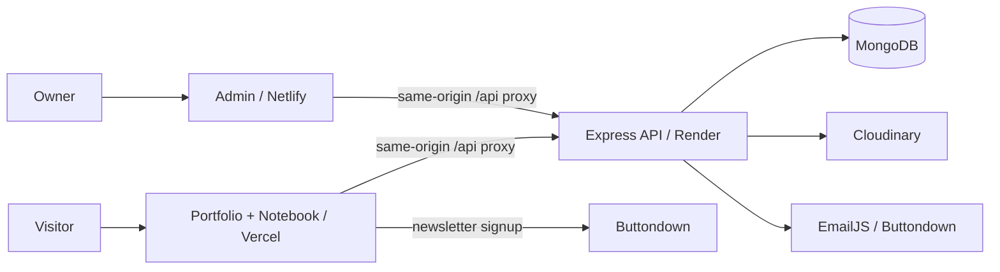

<div align="center">

# Ayush Gupta · Portfolio & Notebook

### Build. Learn. Share.

A personal portfolio, a community notebook, and a private publishing workspace — connected through one secure API.


[Explore portfolio](https://ayushgupta-portfolio.vercel.app/) · [Read the notebook](https://ayushgupta-portfolio.vercel.app/notes) · [Owner workspace](https://ayushgupta-portfolio-admin.netlify.app/) · [API health](https://ayush-portfolio-w1ge.onrender.com/api/health)

</div>

---

> **Deployment note:** Both frontends use `/api` and forward requests to Render. Set `NODE_ENV=production` on Render so secure admin session cookies work. Never place service secrets in `VITE_*` variables.

## Explore

[Features](#features) · [Architecture](#architecture) · [Local setup](#local-setup) · [Environment](#environment) · [Publishing workflow](#publishing-workflow) · [Deployment](#deployment) · [Troubleshooting](#troubleshooting) · [Checks](#checks) · [Security](#security-and-operational-limits)

## Features

| Experience | What it includes |
| --- | --- |
| Portfolio | Profile, projects, skills, experience, certificates, resume and contact form |
| Notebook | Category counts, search, notes, resource posts, PDF attachments and optional cover images |
| Resource discovery | Share YouTube videos/channels, GitHub repositories, apps and useful HTTPS links |
| Community contributions | Submit notes with optional topic and supporting files; owner review before publication |
| Private admin | Edit portfolio, manage note statuses, review submissions, delete rejected notes, manage covers and attachments |
| Newsletter | Buttondown signup and explicitly requested publish/update notifications |
| Presentation | Responsive layouts, light/dark themes, scroll effects and reduced-motion support |
| Authentication | Owner email/password, authenticator code, secure sessions and CSRF protection |

Public note dates use the visitor’s locale and show the date only. Admin entries include date and time for content management.

GitHub README pages do not execute custom JavaScript or CSS animations. This document uses native diagrams, badges and expandable panels; interactive effects belong to the application itself.

## Architecture



| Directory | Responsibility |
| --- | --- |
| `src/` | Public React application, notebook and contribution form |
| `public/` | Public static assets |
| `admin/src/` | Private React workspace and login form |
| `admin/public/` | Netlify proxy rules and security headers |
| `backend/src/` | API, authentication, validation, media and provider integrations |
| `backend/test/` | Automated backend regression tests |
| `backend/scripts/` | Database initialization and maintenance utilities |
| `backend/migrations/` | Migration ledgers and generated cover resources |
| `shared/` | Shared browser configuration and validation rules |

Three apps have separate package manifests and lockfiles. Backend imports shared repository files, so deploy Render from the repository root.

## Local setup

### 1. Prerequisites

- Node.js compatible with Vite 7; Node 22.12+ or Node 24 is suitable. Keep local and hosting versions aligned.
- npm and Git.
- MongoDB Community Server or MongoDB Atlas.
- An authenticator app for owner access.
- Cloudinary for media; EmailJS and Buttondown for their respective email workflows.

### 2. Install dependencies

```sh
git clone https://github.com/ayush-gupta456/ayush_portfolio.git
cd ayush_portfolio
npm ci
npm ci --prefix admin
npm ci --prefix backend
```

### 3. Create local configuration

Create `.env`, `admin/.env` and `backend/.env` manually using the templates below. These files are ignored by Git. Do not assume example files exist in every checkout.

Root `.env`:

```dotenv
VITE_API_URL=http://localhost:8787/api
VITE_BUTTONDOWN_USERNAME=ayushgupta-notes
```

`admin/.env`:

```dotenv
VITE_API_URL=http://localhost:8787/api
VITE_PUBLIC_URL=http://localhost:5174
```

`backend/.env` minimum local configuration:

```dotenv
NODE_ENV=development
PORT=8787
MONGODB_URI=mongodb://127.0.0.1:27017/ayush_portfolio
MONGODB_DB_NAME=ayush_portfolio
ADMIN_EMAIL=owner@example.com
ADMIN_PASSWORD=replace-with-a-unique-password-at-least-14-characters
ADMIN_TOTP_SECRET=REPLACE_WITH_GENERATED_BASE32_SEED
PUBLIC_ORIGIN=http://localhost:5174
ADMIN_ORIGIN=http://localhost:4176
SESSION_COOKIE_NAME=portfolio_admin
COOKIE_SAME_SITE=lax
TRUST_PROXY_HOPS=0
```

Generate and enroll the authenticator seed locally:

```sh
npm run mfa:setup --prefix backend
```

Keep the generated seed private. For Atlas, use its driver connection URI and configure network access; the Atlas dashboard URL is not a database URI.

### 4. Initialize and start

With MongoDB available and configuration complete:

```sh
npm run init-db --prefix backend
```

This prepares collections/indexes and starter content. Review initialization scripts before using them against an existing production database.

Run each command in a separate terminal:

```sh
npm run dev --prefix backend
npm run dev
npm run dev --prefix admin
```

| App | Local address |
| --- | --- |
| Portfolio | http://localhost:5174 |
| Notebook | http://localhost:5174/notes |
| Admin | http://localhost:4176 |
| API health | http://localhost:8787/api/health |

Use `localhost` consistently while developing. Sign in with the configured owner credentials and a fresh six-digit authenticator code.

## Environment

### Browser configuration — public values only

| Variable | Application | Purpose |
| --- | --- | --- |
| `VITE_API_URL` | Public + admin | API base; `/api` for production proxies |
| `VITE_PUBLIC_URL` | Admin | Link back to the public portfolio |
| `VITE_BUTTONDOWN_USERNAME` | Public | Newsletter signup destination |

Vite embeds these values at build time. Changing them requires a new frontend build/deploy.

### Backend integrations

Configure these only in the backend environment or hosting secret manager:

| Integration | Variables |
| --- | --- |
| Database | `MONGODB_URI`, `MONGODB_DB_NAME` |
| Owner access | `ADMIN_EMAIL`, `ADMIN_PASSWORD`, `ADMIN_TOTP_SECRET` |
| Origins | `PUBLIC_ORIGIN`, `ADMIN_ORIGIN`, `NEWSLETTER_PUBLIC_ORIGIN` |
| Sessions | `SESSION_COOKIE_NAME`, `COOKIE_SAME_SITE` |
| Runtime | `NODE_ENV`, `PORT`, `TRUST_PROXY_HOPS` |
| Cloudinary | `CLOUDINARY_CLOUD_NAME`, `CLOUDINARY_API_KEY`, `CLOUDINARY_API_SECRET` |
| Contact email | `EMAILJS_SERVICE_ID`, `EMAILJS_PUBLIC_KEY`, `EMAILJS_PRIVATE_KEY`, `EMAILJS_MAIN_TEMPLATE_ID`, `EMAILJS_AUTOREPLY_TEMPLATE_ID` |
| Buttondown | `BUTTONDOWN_API_KEY` |
| Optional Resend flow | `RESEND_API_KEY`, `RESEND_FROM` |

Provider availability and account limits affect delivery. An accepted API request does not prove delivery to an inbox. Configure and verify the intended provider before enabling notifications.

## Publishing workflow

1. Sign into the owner workspace.
2. Open **Notebook**, create an entry or review a community submission.
3. Choose a category and optionally add a topic, reference URLs and files.
4. Add an optional **card cover** independently of PDF attachments. Prefer Cloudinary images.
5. Save a draft or publish after review. Visitors cannot publish directly.
6. Explicitly choose subscriber notification when intended; retry reported failures from the editor.

Uploads accept supported PDF/image formats, with a 10 MB per-file limit. The cover picker accepts PNG, JPEG and WebP images. Removing a cover reference does not automatically delete the Cloudinary asset.

Portfolio media uploads update the draft; save the portfolio to publish them. Concurrent editing uses version checks to prevent silent overwrites.

<details>
<summary><strong>Contact form behavior</strong></summary>

The backend validates input and email-domain mail routing, uses a honeypot, and limits submissions to two per normalized email address per rolling 24 hours plus four per IP per hour. DNS checks do not prove that an individual mailbox exists.

Contact records retain the sender’s name and email. Subject/message content is used for delivery rather than stored as an inbox archive. Delivery failures and partial successes are reported explicitly.

</details>

## Deployment

### Public frontend · Vercel

| Setting | Value |
| --- | --- |
| Root directory | Repository root |
| Preset | Vite |
| Install | `npm ci` |
| Build | `npm run build` |
| Output | `dist` |

Set `VITE_API_URL=/api` and the public Buttondown username. Root `vercel.json` forwards `/api/*` to Render and serves `/notes` through the frontend entry point.

### Private admin · Netlify

| Setting | Value |
| --- | --- |
| Base directory | Empty / repository root |
| Build | `npm ci --prefix admin && npm run build --prefix admin` |
| Publish directory | `admin/dist` |

Set:

```dotenv
VITE_API_URL=/api
VITE_PUBLIC_URL=https://ayushgupta-portfolio.vercel.app
```

Vite copies `admin/public/_redirects` and `_headers` into the build. Netlify uses these files; it does not use `admin/vercel.json`. The latter supports deploying the admin to Vercel instead.

### Backend · Render

| Setting | Value |
| --- | --- |
| Service | Node web service |
| Root directory | Empty / repository root |
| Build | `npm ci --omit=dev --prefix backend` |
| Start | `npm start --prefix backend` |
| Health path | `/api/health` |

Set the backend secrets plus:

```dotenv
NODE_ENV=production
PUBLIC_ORIGIN=https://ayushgupta-portfolio.vercel.app
ADMIN_ORIGIN=https://ayushgupta-portfolio-admin.netlify.app
NEWSLETTER_PUBLIC_ORIGIN=https://ayushgupta-portfolio.vercel.app
SESSION_COOKIE_NAME=__Host-portfolio_admin
COOKIE_SAME_SITE=lax
```

Use Render’s assigned port. Origins must match the actual deployed domains exactly, without trailing slashes. Configure `TRUST_PROXY_HOPS` for the real trusted proxy chain; do not copy the local value blindly. Production MongoDB must use TLS.

If the Render hostname changes, update both frontend proxy configurations. If frontend domains change, update backend origins and newsletter/public links.

### Release checklist

- [ ] Configure secrets separately on the backend.
- [ ] Initialize the intended database and verify access restrictions.
- [ ] Run checks and dependency audits.
- [ ] Commit/push all routing files before deploying.
- [ ] Deploy the backend and both frontend builds.
- [ ] Verify each frontend’s `/api/health` returns JSON with `status: ok`.
- [ ] Sign in, refresh, sign out, and confirm session behavior.
- [ ] Check notes, covers, PDF links and both themes.
- [ ] Verify forms with controlled data and recipients; avoid test broadcasts to real subscribers.

## Troubleshooting

| Symptom | Cause / action |
| --- | --- |
| `/api` says “Not found” | Use `/api/health`; the bare API root has no route. |
| Frontend `/api/health` returns HTML or 404 | Ensure proxy files are committed, included in the correct build and deployed. |
| `__Host- session cookies require NODE_ENV=production` | Set exactly `NODE_ENV=production` on Render, then redeploy. |
| Session endpoint returns 401 before login | Expected for a signed-out visitor. |
| Login succeeds, then session fails | Check browser blocked-cookie details, same-origin `/api` configuration and backend secure-cookie settings. Never share cookie values. |
| Sessions fail after credential changes | Sign in again. Credential rotation invalidates existing sessions. |
| Authenticator code rejected | Enable automatic device time and use a fresh code; used time steps cannot be replayed. |
| Origin error / 403 | Check exact `ADMIN_ORIGIN` / `PUBLIC_ORIGIN` and CSRF handling. |
| Old frontend environment value remains | Rebuild and redeploy; changing dashboard variables alone does not change built JavaScript. |
| CSP warnings mention `about:srcdoc` | Netlify’s injected badge can cause these. Disable **Project configuration → General → Powered by Netlify badge** rather than weakening CSP. |
| Media or newsletter unavailable | Verify server-side provider credentials, account permissions and delivery/file restrictions. |

See [Netlify’s badge documentation](https://docs.netlify.com/manage/projects/powered-by-netlify-badge/) for its CSP behavior.

## Checks

```sh
npm run lint
npm run check:api
npm run test:api
npm run build:all
npm run security:audit
```

Or run the combined lint, syntax, tests and builds:

```sh
npm run security:check
```

Automated tests cover validation, origin/CSRF controls, note moderation, uploads, contact quotas, newsletter failure handling and credential-version stability. These checks do not replace live cookie, database, provider-delivery or accessibility verification.

## Security and operational limits

- Argon2id password verification and TOTP authentication protect owner access.
- Random session identifiers are stored as hashes; production cookies are HttpOnly, Secure and SameSite-protected.
- Exact origin checks, CSRF tokens, rate limits, strict schemas and security headers enforce server-side controls.
- Credential versions remain stable across restarts and change when owner credentials rotate.
- Keep secrets out of Git and frontend variables. Rotate any previously exposed credentials; deleting text does not revoke a key.
- File signature checks are not malware scanning. Review community documents before publishing.
- Use a database account with minimal permissions, backups and a tested restore process.
- Newsletter/email work is not a durable background queue; retries and provider status require monitoring.
- List limits and pending-file retention need consideration as content and traffic grow.

## Maintenance and contributions

Create a focused branch, keep changes small, run the applicable checks and describe behavior changes in a pull request. Never include private documents, environment files or credentials.

Historical Python source-rewrite scripts are maintenance artifacts, not normal startup steps. Do not rerun them blindly. Preserve migration ledgers until their ownership and retry purpose are understood.

For remaining refactoring and performance priorities, read [the production code review](PRODUCTION_CODE_REVIEW.md).

---

<div align="center">

**Made by Ayush Gupta**

[Portfolio](https://ayushgupta-portfolio.vercel.app/) · [Notebook](https://ayushgupta-portfolio.vercel.app/notes) · [GitHub](https://github.com/ayush-gupta456)

</div>
